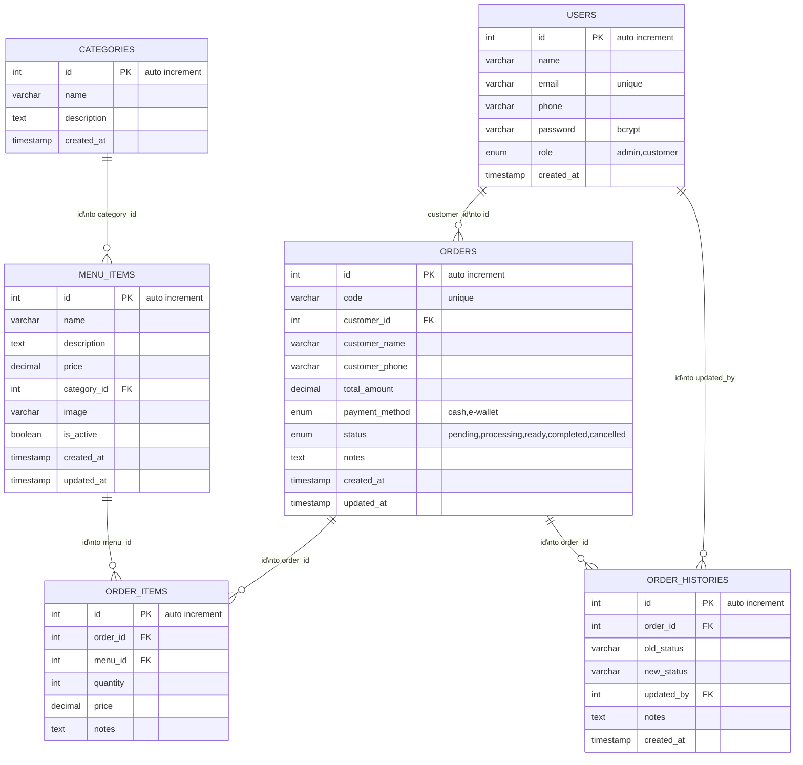

# Entity Relationship Diagram (ERD)
# Database Schema — Sistem Pemesanan Makanan "Lahap"

## ER Diagram (Mermaid)

---

## 1. `users`
Tabel pengguna (admin & customer)

| Kolom | Tipe | Constraint | Deskripsi |
|-------|------|------------|-----------|
| `id` | INT | PK, AUTO_INCREMENT | Primary key |
| `name` | VARCHAR(100) | NOT NULL | Nama lengkap |
| `email` | VARCHAR(100) | UNIQUE, NOT NULL | Email unik untuk login |
| `phone` | VARCHAR(20) | NULL | Nomor telepon opsional |
| `password` | VARCHAR(255) | NOT NULL | Password hash (bcrypt) |
| `role` | ENUM | DEFAULT 'customer' | `admin` / `customer` |
| `created_at` | TIMESTAMP | DEFAULT CURRENT_TIMESTAMP | Waktu akun dibuat |

**Indeks:** `email` (unique)

---

## 2. `categories`
Tabel kategori menu

| Kolom | Tipe | Constraint | Deskripsi |
|-------|------|------------|-----------|
| `id` | INT | PK, AUTO_INCREMENT | Primary key |
| `name` | VARCHAR(50) | NOT NULL | Nama kategori (e.g., "Nasi", "Mie") |
| `description` | TEXT | NULL | Deskripsi kategori |
| `created_at` | TIMESTAMP | DEFAULT CURRENT_TIMESTAMP | |

**Indeks:** Primary key `id`

---

## 3. `menu_items`
Tabel menu makanan

| Kolom | Tipe | Constraint | Deskripsi |
|-------|------|------------|-----------|
| `id` | INT | PK, AUTO_INCREMENT | Primary key |
| `name` | VARCHAR(100) | NOT NULL | Nama makanan (e.g., "Nasi Goreng") |
| `description` | TEXT | NULL | Deskripsi menu |
| `price` | DECIMAL(10,2) | NOT NULL | Harga |
| `category_id` | INT | FK → categories.id | Kategori menu |
| `image` | VARCHAR(255) | NULL | Path upload gambar |
| `is_active` | BOOLEAN | DEFAULT TRUE | Menu bisa disembunyikan |
| `created_at` | TIMESTAMP | DEFAULT CURRENT_TIMESTAMP | |
| `updated_at` | TIMESTAMP | ON UPDATE CURRENT_TIMESTAMP | |

**Indeks:** `category_id`, `is_active`

---

## 4. `orders`
Tabel pesanan utama

| Kolom | Tipe | Constraint | Deskripsi |
|-------|------|------------|-----------|
| `id` | INT | PK, AUTO_INCREMENT | Primary key |
| `code` | VARCHAR(20) | UNIQUE, NOT NULL | Kode order: `ORD-YYYYMMDD-HHMMSS` |
| `customer_id` | INT | FK → users.id, NULL | ID customer (NULL jika guest) |
| `customer_name` | VARCHAR(100) | NOT NULL | Nama customer |
| `customer_phone` | VARCHAR(20) | NULL | Nomor HP customer |
| `total_amount` | DECIMAL(10,2) | NOT NULL | Total harga semua item |
| `payment_method` | ENUM | NOT NULL | `cash` / `e-wallet` |
| `status` | ENUM | DEFAULT 'pending' | `pending`, `processing`, `ready`, `completed`, `cancelled` |
| `notes` | TEXT | NULL | Catatan khusus |
| `created_at` | TIMESTAMP | DEFAULT CURRENT_TIMESTAMP | |
| `updated_at` | TIMESTAMP | ON UPDATE CURRENT_TIMESTAMP | |

**Indeks:** `code` (unique), `status`, `customer_id`, `created_at`

---

## 5. `order_items`
Item detail dalam setiap pesanan

| Kolom | Tipe | Constraint | Deskripsi |
|-------|------|------------|-----------|
| `id` | INT | PK, AUTO_INCREMENT | Primary key |
| `order_id` | INT | FK → orders.id | Pesanan induk |
| `menu_id` | INT | FK → menu_items.id | Menu yang dipesan |
| `quantity` | INT | DEFAULT 1 | Jumlah pesan |
| `price` | DECIMAL(10,2) | NOT NULL | Harga per item (snapshot) |
| `notes` | TEXT | NULL | Catatan khusus per item |

**Indeks:** `order_id`, `menu_id`

---

## 6. `order_histories`
Log perubahan status pesanan

| Kolom | Tipe | Constraint | Deskripsi |
|-------|------|------------|-----------|
| `id` | INT | PK, AUTO_INCREMENT | Primary key |
| `order_id` | INT | FK → orders.id | Pesanan yang berubah |
| `old_status` | VARCHAR(20) | NULL | Status sebelumnya |
| `new_status` | VARCHAR(20) | NOT NULL | Status baru |
| `updated_by` | INT | FK → users.id, NULL | Admin yang mengubah |
| `notes` | TEXT | NULL | Catatan tambahan |
| `created_at` | TIMESTAMP | DEFAULT CURRENT_TIMESTAMP | Kapan perubahan terjadi |

**Indeks:** `order_id`, `created_at`

---

## Relationships

| From (Child) | To (Parent) | Foreign Key | On Delete |
|--------------|-------------|-------------|-----------|
| `menu_items.category_id` | `categories.id` | `category_id` | SET NULL |
| `orders.customer_id` | `users.id` | `customer_id` | SET NULL |
| `order_items.order_id` | `orders.id` | `order_id` | CASCADE |
| `order_items.menu_id` | `menu_items.id` | `menu_id` | CASCADE |
| `order_histories.order_id` | `orders.id` | `order_id` | CASCADE |
| `order_histories.updated_by` | `users.id` | `updated_by` | SET NULL |
